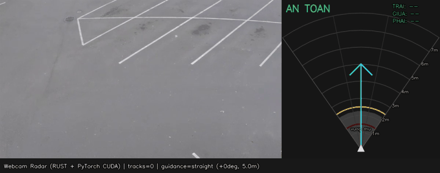

# Webcam Radar

Turn a laptop webcam into a **real-time 2D spatial radar & collision warning system** (Bird's-Eye View): detects people and obstacles with YOLO, estimates metric floor positions via 2-axis (`pitch` + `roll`) camera geometry, Pose keypoints, and Depth Anything V2 (raised obstacles, step drop-offs, and overhead hazards), compensates for walking camera motion (`Ego-Motion`), maintains a 2D local occupancy grid with safe steering guidance, accelerates heavy math in Rust (`radar_rs`), and renders a **lightweight Web HUD (HTML5 Canvas 2D Radar + Web Spatial Audio)**.

## Demo Output



- **High-resolution frame preview:** [assets/demo_preview.png](assets/demo_preview.png)
- **Full rendered output video (647 frames):** [demo_output.mp4](demo_output.mp4) (rendered from [demo_street.mp4](demo_street.mp4) at `height=3.5m`, `pitch=36°`)

## Installation

```bash
pip install -r requirements.txt
```

### Build the Rust acceleration module (`radar_rs`, optional)
If Rust (`cargo`, `rustc`) and `maturin` are installed:

```bash
cd radar_rs
maturin develop --release
# Optional direct WinRT accelerometer support (Windows):
# maturin develop --release --features win-sensor
```

If `radar_rs` is not built, `core/accel.py` automatically falls back to an equivalent pure-Python/NumPy implementation.

## Usage

```bash
python web.py                                 # Web HUD from webcam: http://localhost:8000
python web.py --video demo_street.mp4 --no-sensor --height 3.5 --pitch 36
python radar.py                               # Desktop OpenCV window (supports --pose --depth --kalman --sensor)
```

Key CLI options: `--cam`, `--video`, `--hfov`, `--height`, `--pitch`, `--no-pose`, `--no-depth`, `--no-sensor`, `--no-ego`, `--backend auto|pytorch|onnx|openvino`, `--depth-backend auto|pytorch|onnx|openvino`, `--det-every 3`, `--imgsz 320`, `--threads 4`, `--port 8000`.

User settings (`pitch`, `offset`, `height`, `hfov`, `calib_dist`, `flip`, `muted`, `voice_enabled`, `spatial_audio`, `radar_range`) are automatically persisted to `config.json`.

## Architecture

- `core/`: `config.py`, `camera.py`, `estimator.py`, `tracker.py`, `depth.py`, `ego.py`, `accel.py`, `pipeline.py` (Threaded `FrameReader`, `AsyncDepthWorker`, `EgoMotionEstimator`, `RadarEngine`, `CameraHealthMonitor`).
- `radar_rs/`: PyO3 Rust crate accelerating RANSAC/Huber depth fitting, `168×128` grid scanning + clustering + drop-off + overhead hazard detection, multi-tier occlusion resolution, `KalmanTrackerRs` (Ego-motion compensation + Hungarian assignment + Joseph form + adaptive TTL + TTC/CPA), and `OccupancyGridRs` (`60×60` local grid + VFH+ Safe Steering).
- `web.py`, `web.html`, `static/`: Server-Sent Events (`/events`), on-demand MJPEG (`/stream`), `/state`, `/cmd`, Canvas 2D Radar (`radar.js`), Web Spatial Audio & speech alerts (`audio.js`), and HUD controller (`app.js`).

## Testing & Benchmark

```bash
pytest -v
python benchmark.py --video demo_street.mp4 --frames 150
python benchmark.py --record out_dir --frames 120
python benchmark.py --replay out_dir --frames 120
```
